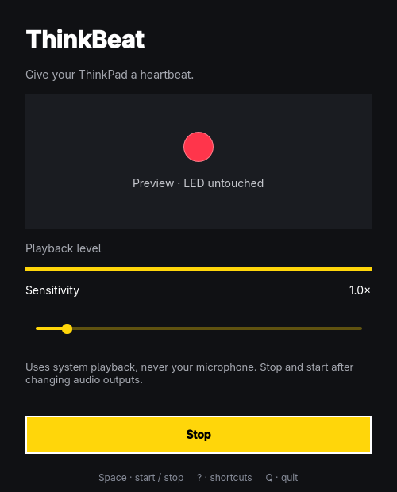

# ThinkBeat

A small C++/Qt Quick Linux app that pulses the red dot on a ThinkPad lid to
the audio playing on your computer. It listens to the **output monitor**, not
your microphone. Audio stays in memory and is not recorded to disk.

## Run

```sh
./bin/build
./bin/enable-led
./build/thinkbeat
```

Play something and click **Start listening** (or press Space). Adjust
sensitivity for quieter audio. The dot in the window previews the real LED.
Stop and start again after changing audio outputs.

The permission helper uses sudo to change ownership of **only** the lid LED's
`brightness` and `trigger` attributes to the current user. Run it as your
desktop user, **not** as `sudo bin/enable-led`. The app itself never needs root.
Permissions reset after reboot or a `thinkpad_acpi` reload; run the helper again.
No permanent root service or system configuration is installed.

## Install on Arch / Omarchy

```sh
./bin/install --noconfirm
thinkbeat-enable-led
thinkbeat
```

The package adds ThinkBeat to the app launcher, plus `thinkbeat-enable-led`.
Remove with `sudo pacman -R thinkbeat`.

Build requirements: C++17 compiler, make, qmake6, Qt 6 base and declarative.
Runtime requirements: Qt Quick Controls, Qt Wayland on Wayland desktops,
`parec` (Arch: `libpulse`; Debian/Ubuntu: `pulseaudio-utils`), and a working
PulseAudio server or PipeWire with `pipewire-pulse`. Other distributions can
build and run the binary directly; the package installer is Arch-specific.

## Command line

```sh
thinkbeat --start          # Open the window and start listening.
thinkbeat --preview       # Show playback pulses without touching the LED.
thinkbeat --headless      # No window; Ctrl+C / SIGTERM stops and restores the LED.
thinkbeat --check --json  # Machine-readable dependency/permission check; no writes.
```

`--check` exits 0 if the LED exists, is writable, and `parec` is available;
otherwise it exits 1. It does not probe the audio server. Capture failures
appear in the window, or on stderr with exit status 1 in headless mode.
Only one non-preview instance can run per desktop user.

| Key | Action |
| --- | --- |
| Space | Start / stop |
| ? | Show / hide shortcuts |
| Esc | Close shortcut help |
| Q | Quit |

## How it works

`parec` provides mono 48 kHz signed 16-bit playback samples. C++ processes
20 ms RMS windows, detects rises above a moving energy floor, and emits short
LED flashes. Sustained audio produces slower pulses rather than a solid light.
Sensitivity adjusts the noise gate and level display. This is a sound-reactive
visualizer, **not a BPM estimator or a sample-accurate beat tracker**.

Only `/sys/class/leds/tpacpi::lid_logo_dot` is controlled. Brightness and the
active kernel trigger are saved before listening, then restored on stop,
normal exit, Ctrl+C, SIGTERM, and capture errors. A two-second watchdog stops
capture if sample delivery stalls. SIGKILL, crashes, or power loss cannot run
cleanup; reboot resets the device. Do not use another LED controller at the
same time. Firmware may limit responsiveness, and ThinkPads without this
sysfs LED are not supported.

Omarchy accent, corner rounding, locale, and language are followed live, with
English fallback and Swedish and Danish translations. The app also runs
without Omarchy.

## Tests

```sh
./bin/test
THINKBEAT_TEST_SCREENSHOT="$PWD/build/screenshot.png" ./bin/test
```

Tests use temporary LED files and fake capture processes: no sudo, real LED
changes, or speaker output. They cover PCM framing, noise gating, pulse timing,
capture failures, watchdog cleanup, state restoration, live theme/language
changes, and actual QML keyboard/mouse interaction. The screenshot uses
synthetic audio and the default accent, not personal desktop content.

The real hardware path was also tested on the development ThinkPad using a
temporary silent PipeWire null sink, observing LED transitions and verifying
restoration after SIGTERM without changing the default audio output.
